# Mule Create – Introduction

18 pictures of the most important functions, each from the real program. Click through with the links under each picture.

> Any question about Mule: give the file AI_HANDBOOK.md to your AI (Claude, ChatGPT, Codex …) and ask it – it describes every function, shortcut and workflow.

## Contents

1. [The window](#1-the-window)
2. [Pen and brush – both draw lines](#2-pen-and-brush--both-draw-lines)
3. [Draw mode and Paint mode](#3-draw-mode-and-paint-mode)
4. [Free mode (Q) – drawing without a plane](#4-free-mode-q--drawing-without-a-plane)
5. [Straight lines and shapes: hold still](#5-straight-lines-and-shapes-hold-still)
6. [Own planes: Space+N](#6-own-planes-spacen)
7. [Edit mode (Tab): select and transform](#7-edit-mode-tab-select-and-transform)
8. [Extrude (X)](#8-extrude-x)
9. [Loft (Shift+F)](#9-loft-shiftf)
10. [Surface from lines (F)](#10-surface-from-lines-f)
11. [Insert a point (Ctrl+click)](#11-insert-a-point-ctrlclick)
12. [Delete points (point mode)](#12-delete-points-point-mode)
13. [Groups and generators: Symmetry](#13-groups-and-generators-symmetry)
14. [Notes (N) and the note board](#14-notes-n-and-the-note-board)
15. [Hero camera](#15-hero-camera)
16. [Export Sketch Brief (Ctrl+E)](#16-export-sketch-brief-ctrle)
17. [Review: talk your feedback](#17-review-talk-your-feedback)
18. [Shots: what happens when](#18-shots-what-happens-when)

## 1. The window

Mule has four modes: Draw puts lines down, Edit changes them, Notes holds prompts for the AI, Shots shows timing. Any question about Mule: give the file AI_HANDBOOK.md to your AI and ask it.

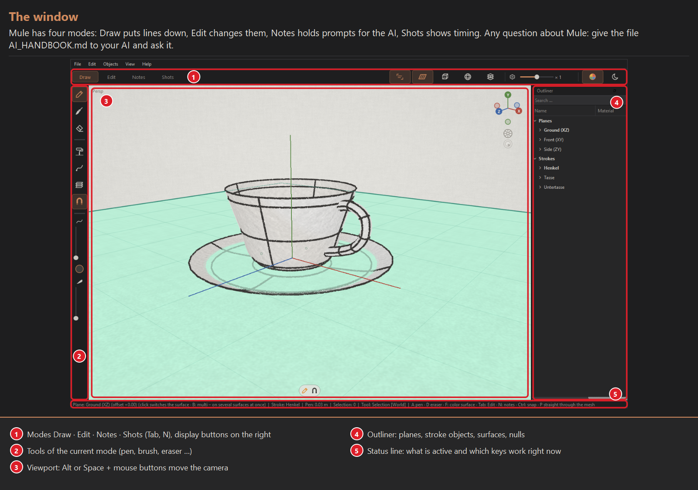

- **1** Modes Draw · Edit · Notes · Shots (Tab, N), display buttons on the right
- **2** Tools of the current mode (pen, brush, eraser …)
- **3** Viewport: Alt or Space + mouse buttons move the camera
- **4** Outliner: planes, stroke objects, surfaces, nulls
- **5** Status line: what is active and which keys work right now

[Contents](#contents) · [Pen and brush – both draw lines →](#2-pen-and-brush--both-draw-lines)

## 2. Pen and brush – both draw lines

Pen and brush both draw lines you can edit and build surfaces from. The only difference is the look: the pen draws grey pencil, the brush draws in the current colour.

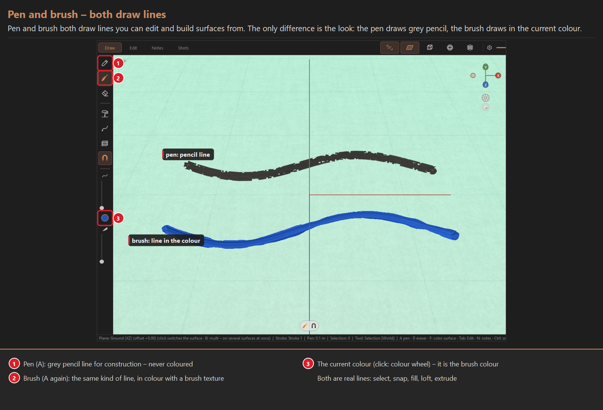

- **1** Pen (A): grey pencil line for construction – never coloured
- **2** Brush (A again): the same kind of line, in colour with a brush texture
- **3** The current colour (click: colour wheel) – it is the brush colour
- Both are real lines: select, snap, fill, loft, extrude

[← The window](#1-the-window) · [Contents](#contents) · [Draw mode and Paint mode →](#3-draw-mode-and-paint-mode)

## 3. Draw mode and Paint mode

In Draw mode pen and brush make lines – the construction. In Paint mode they lay colour flat onto the surface – for look and shading, never for the shape.

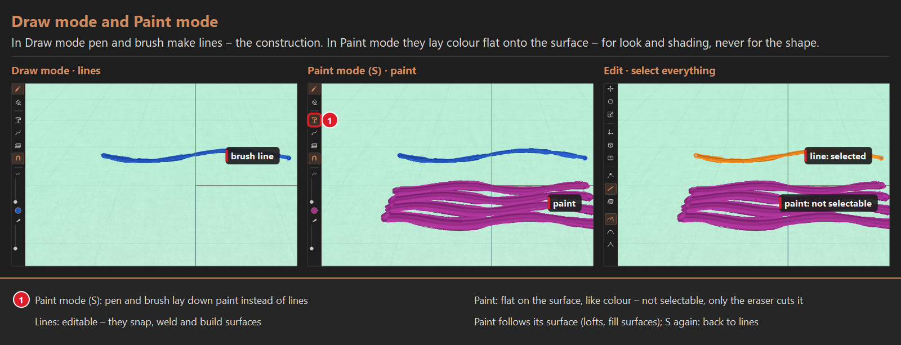

- **1** Paint mode (S): pen and brush lay down paint instead of lines
- Lines: editable – they snap, weld and build surfaces
- Paint: flat on the surface, like colour – not selectable, only the eraser cuts it
- Paint follows its surface (lofts, fill surfaces); S again: back to lines

[← Pen and brush – both draw lines](#2-pen-and-brush--both-draw-lines) · [Contents](#contents) · [Free mode (Q) – drawing without a plane →](#4-free-mode-q--drawing-without-a-plane)

## 4. Free mode (Q) – drawing without a plane

Free mode draws in space without a plane: the stroke lies in an imagined plane through its start point, facing the camera. It must start on an existing line or surface; its end may dock somewhere else.

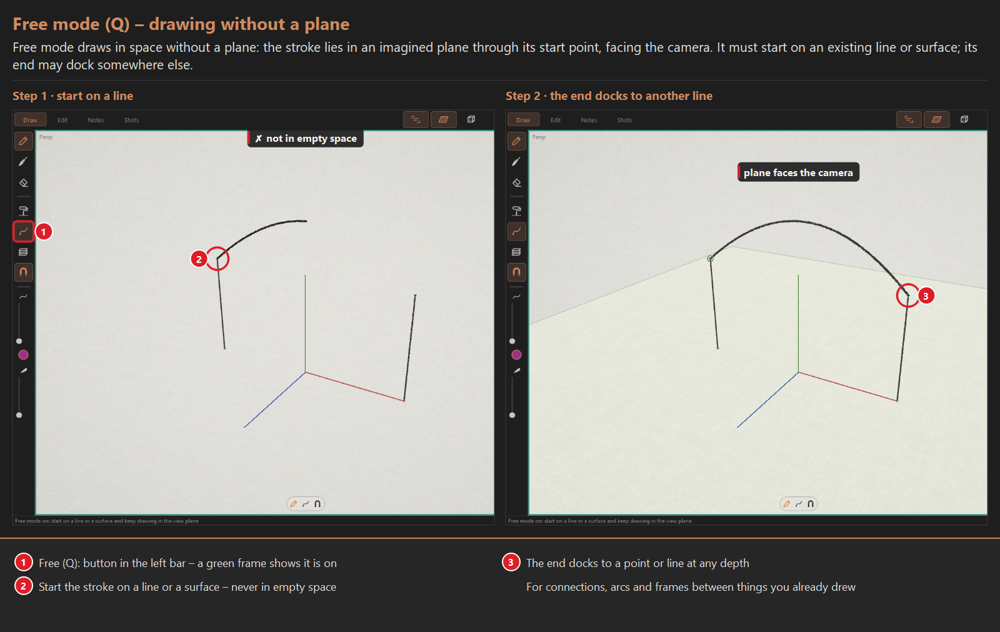

- **1** Free (Q): button in the left bar – a green frame shows it is on
- **2** Start the stroke on a line or a surface – never in empty space
- **3** The end docks to a point or line at any depth
- For connections, arcs and frames between things you already drew

[← Draw mode and Paint mode](#3-draw-mode-and-paint-mode) · [Contents](#contents) · [Straight lines and shapes: hold still →](#5-straight-lines-and-shapes-hold-still)

## 5. Straight lines and shapes: hold still

Draw freely; if you hold still for a moment at the end of a stroke, Mule turns it into a straight line or a clean shape.

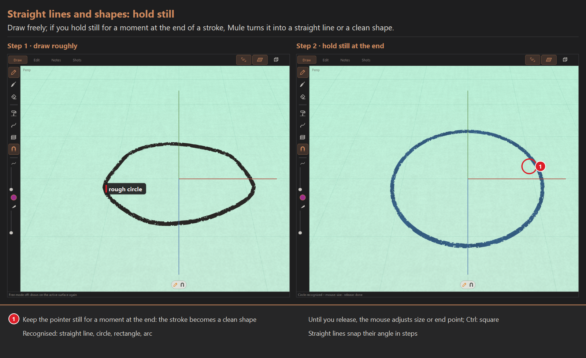

- **1** Keep the pointer still for a moment at the end: the stroke becomes a clean shape
- Recognised: straight line, circle, rectangle, arc
- Until you release, the mouse adjusts size or end point; Ctrl: square
- Straight lines snap their angle in steps

[← Free mode (Q) – drawing without a plane](#4-free-mode-q--drawing-without-a-plane) · [Contents](#contents) · [Own planes: Space+N →](#6-own-planes-spacen)

## 6. Own planes: Space+N

You always draw onto a plane or surface. Space+N creates a new plane exactly where the cursor points – for example at the handle of the cup – so you can draw details there.

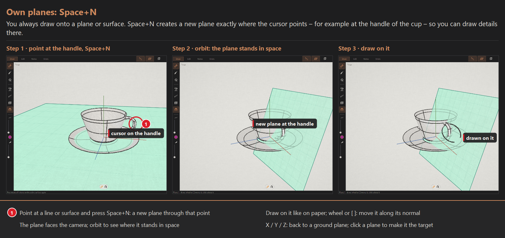

- **1** Point at a line or surface and press Space+N: a new plane through that point
- The plane faces the camera; orbit to see where it stands in space
- Draw on it like on paper; wheel or [ ]: move it along its normal
- X / Y / Z: back to a ground plane; click a plane to make it the target

[← Straight lines and shapes: hold still](#5-straight-lines-and-shapes-hold-still) · [Contents](#contents) · [Edit mode (Tab): select and transform →](#7-edit-mode-tab-select-and-transform)

## 7. Edit mode (Tab): select and transform

Tab switches to Edit mode. Select what you want to change, then T, R or E shows the gizmo to move, rotate or scale it.

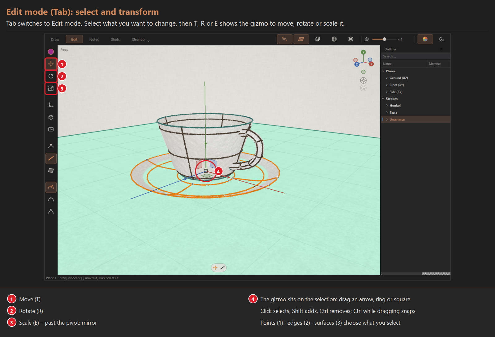

- **1** Move (T)
- **2** Rotate (R)
- **3** Scale (E) – past the pivot: mirror
- **4** The gizmo sits on the selection: drag an arrow, ring or square
- Click selects, Shift adds, Ctrl removes; Ctrl while dragging snaps
- Points (1) · edges (2) · surfaces (3) choose what you select

[← Own planes: Space+N](#6-own-planes-spacen) · [Contents](#contents) · [Extrude (X) →](#8-extrude-x)

## 8. Extrude (X)

Extruding pulls a copy of the selected lines away and builds walls between them – the quickest way from a drawn outline to a volume.

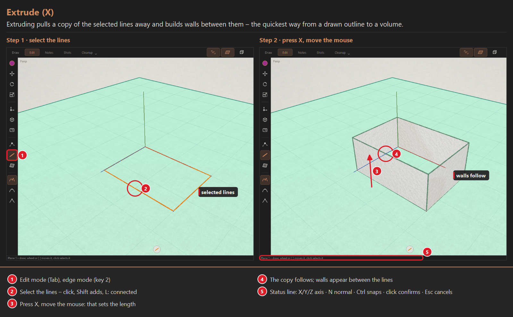

- **1** Edit mode (Tab), edge mode (key 2)
- **2** Select the lines – click, Shift adds, L: connected
- **3** Press X, move the mouse: that sets the length
- **4** The copy follows; walls appear between the lines
- **5** Status line: X/Y/Z axis · N normal · Ctrl snaps · click confirms · Esc cancels

[← Edit mode (Tab): select and transform](#7-edit-mode-tab-select-and-transform) · [Contents](#contents) · [Loft (Shift+F) →](#9-loft-shiftf)

## 9. Loft (Shift+F)

A loft is a curved surface through several cross-sections, like Skin in Houdini: draw the sections, select them in order, press Shift+F.

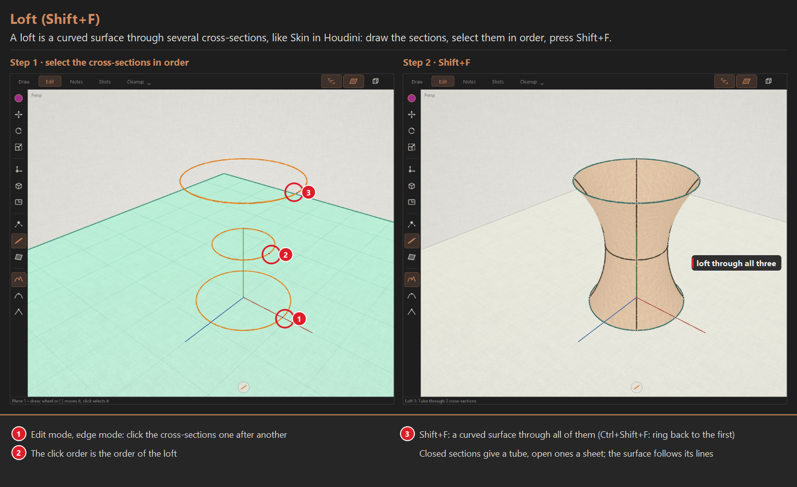

- **1** Edit mode, edge mode: click the cross-sections one after another
- **2** The click order is the order of the loft
- **3** Shift+F: a curved surface through all of them (Ctrl+Shift+F: ring back to the first)
- Closed sections give a tube, open ones a sheet; the surface follows its lines

[← Extrude (X)](#8-extrude-x) · [Contents](#contents) · [Surface from lines (F) →](#10-surface-from-lines-f)

## 10. Surface from lines (F)

Surfaces always come from lines: select lines that close an outline and press F.

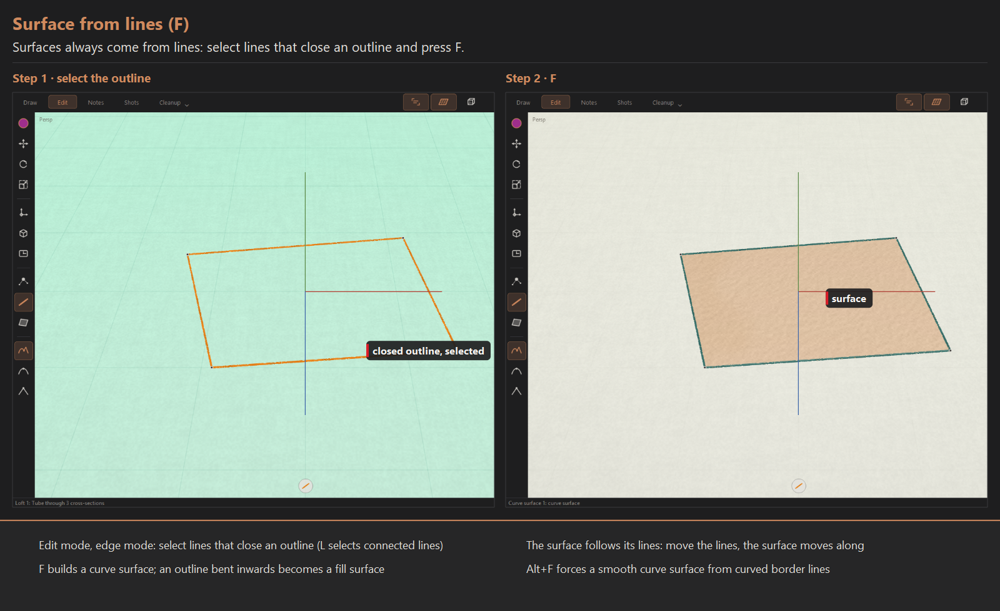

- Edit mode, edge mode: select lines that close an outline (L selects connected lines)
- F builds a curve surface; an outline bent inwards becomes a fill surface
- The surface follows its lines: move the lines, the surface moves along
- Alt+F forces a smooth curve surface from curved border lines

[← Loft (Shift+F)](#9-loft-shiftf) · [Contents](#contents) · [Insert a point (Ctrl+click) →](#11-insert-a-point-ctrlclick)

## 11. Insert a point (Ctrl+click)

Points are where you can grab a line. Ctrl+click on a line adds a point exactly there.

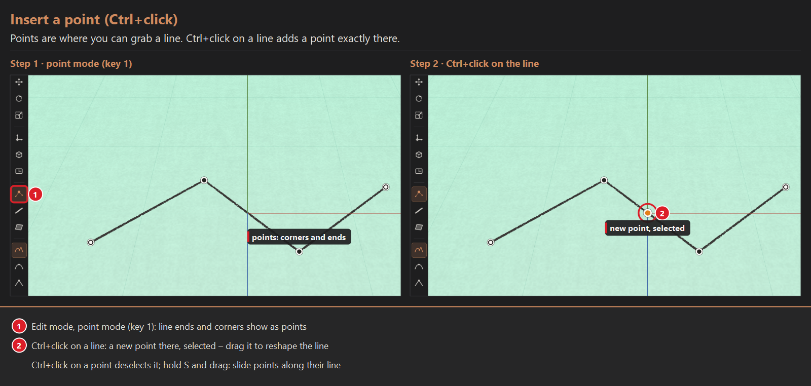

- **1** Edit mode, point mode (key 1): line ends and corners show as points
- **2** Ctrl+click on a line: a new point there, selected – drag it to reshape the line
- Ctrl+click on a point deselects it; hold S and drag: slide points along their line

[← Surface from lines (F)](#10-surface-from-lines-f) · [Contents](#contents) · [Delete points (point mode) →](#12-delete-points-point-mode)

## 12. Delete points (point mode)

Three ways to get rid of a point: dissolve it and keep the shape, remove it and smooth the line, or delete it together with its pieces.

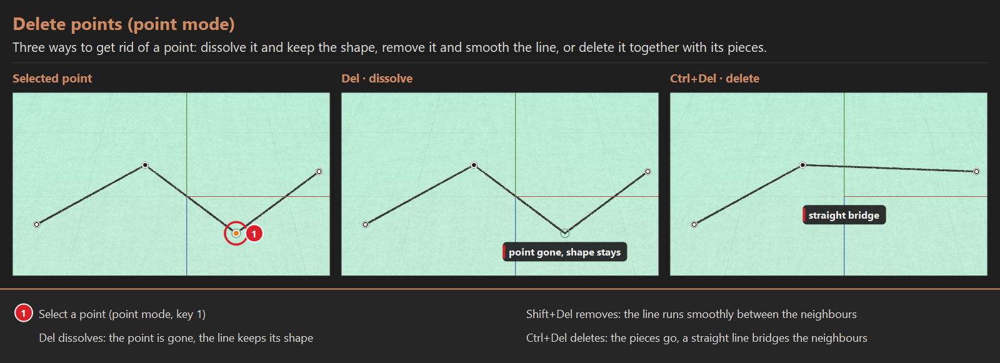

- **1** Select a point (point mode, key 1)
- Del dissolves: the point is gone, the line keeps its shape
- Shift+Del removes: the line runs smoothly between the neighbours
- Ctrl+Del deletes: the pieces go, a straight line bridges the neighbours

[← Insert a point (Ctrl+click)](#11-insert-a-point-ctrlclick) · [Contents](#contents) · [Groups and generators: Symmetry →](#13-groups-and-generators-symmetry)

## 13. Groups and generators: Symmetry

Generators work like in Cinema 4D: put objects under a Symmetry or Array null and Mule shows the copies live.

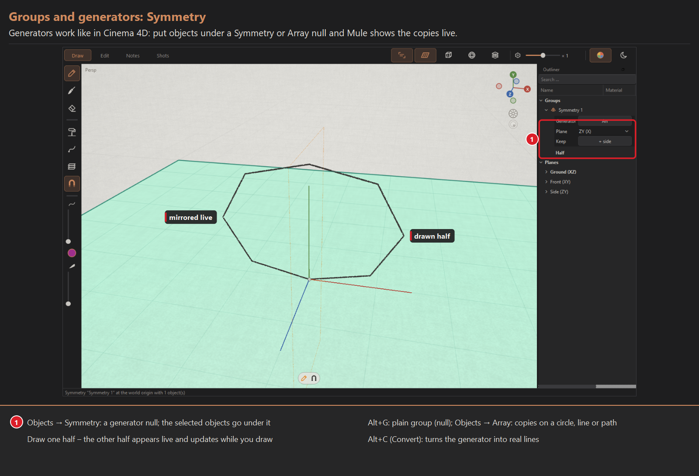

- **1** Objects → Symmetry: a generator null; the selected objects go under it
- Draw one half – the other half appears live and updates while you draw
- Alt+G: plain group (null); Objects → Array: copies on a circle, line or path
- Alt+C (Convert): turns the generator into real lines

[← Delete points (point mode)](#12-delete-points-point-mode) · [Contents](#contents) · [Notes (N) and the note board →](#14-notes-n-and-the-note-board)

## 14. Notes (N) and the note board

Notes are prompts in space: a short heading points at a part, and its board holds everything the AI should know about it. The octopus says which similar parts the same note also means.

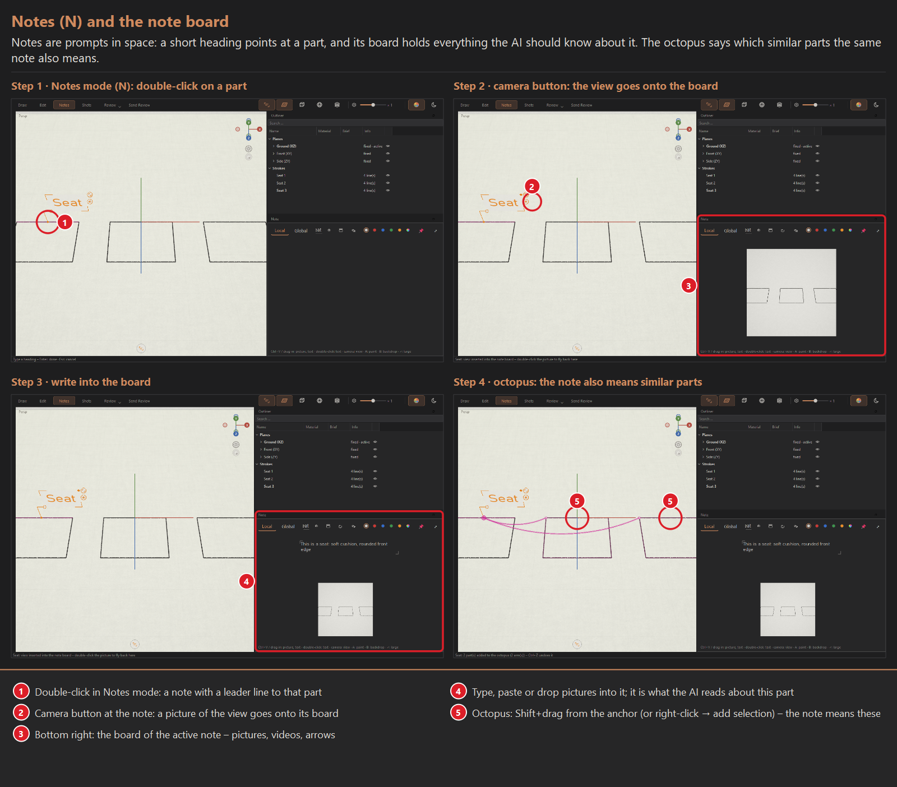

- **1** Double-click in Notes mode: a note with a leader line to that part
- **2** Camera button at the note: a picture of the view goes onto its board
- **3** Bottom right: the board of the active note – pictures, videos, arrows
- **4** Type, paste or drop pictures into it; it is what the AI reads about this part
- **5** Octopus: Shift+drag from the anchor (or right-click → add selection) – the note means these too

[← Groups and generators: Symmetry](#13-groups-and-generators-symmetry) · [Contents](#contents) · [Hero camera →](#15-hero-camera)

## 15. Hero camera

Hero cameras are the views that matter most. Tick a screenshot on a note board as hero camera, and the AI looks through exactly this camera while it builds and reviews.

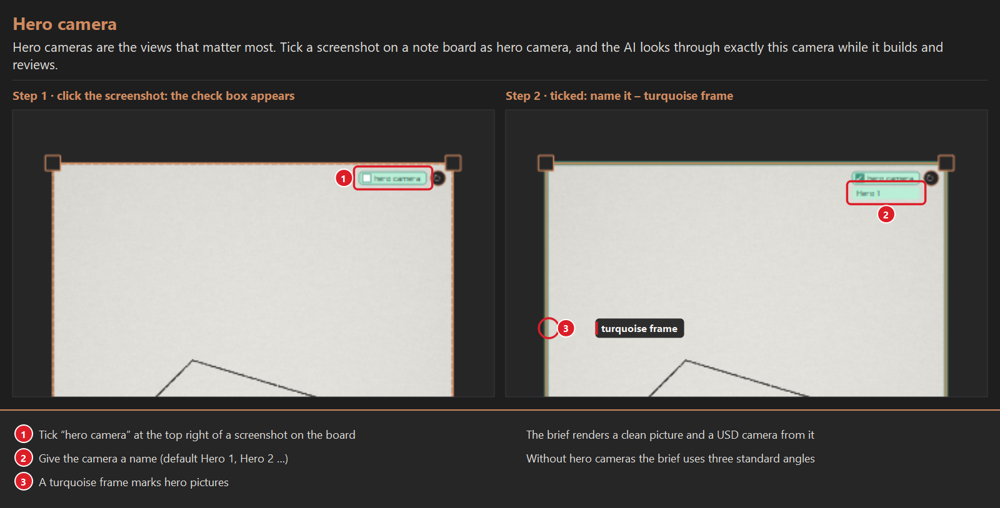

- **1** Tick “hero camera” at the top right of a screenshot on the board
- **2** Give the camera a name (default Hero 1, Hero 2 …)
- **3** A turquoise frame marks hero pictures
- The brief renders a clean picture and a USD camera from it
- Without hero cameras the brief uses three standard angles

[← Notes (N) and the note board](#14-notes-n-and-the-note-board) · [Contents](#contents) · [Export Sketch Brief (Ctrl+E) →](#16-export-sketch-brief-ctrle)

## 16. Export Sketch Brief (Ctrl+E)

The Sketch Brief is the hand-over to the AI: a folder with pictures, notes, the scene as USD and working rules. The dialog asks only for what the AI cannot read from the scene.

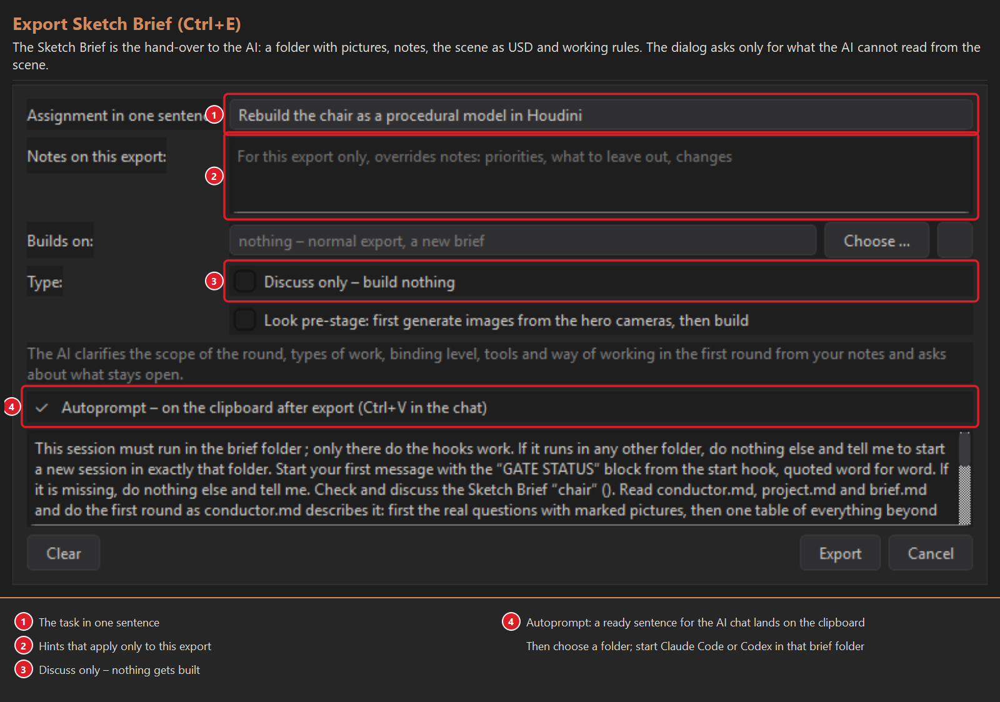

- **1** The task in one sentence
- **2** Hints that apply only to this export
- **3** Discuss only – nothing gets built
- **4** Autoprompt: a ready sentence for the AI chat lands on the clipboard
- Then choose a folder; start Claude Code or Codex in that brief folder

[← Hero camera](#15-hero-camera) · [Contents](#contents) · [Review: talk your feedback →](#17-review-talk-your-feedback)

## 17. Review: talk your feedback

Walk through the scene and talk, like in a review session. Mule records your voice and where you looked and pointed; the AI turns it into draft notes.

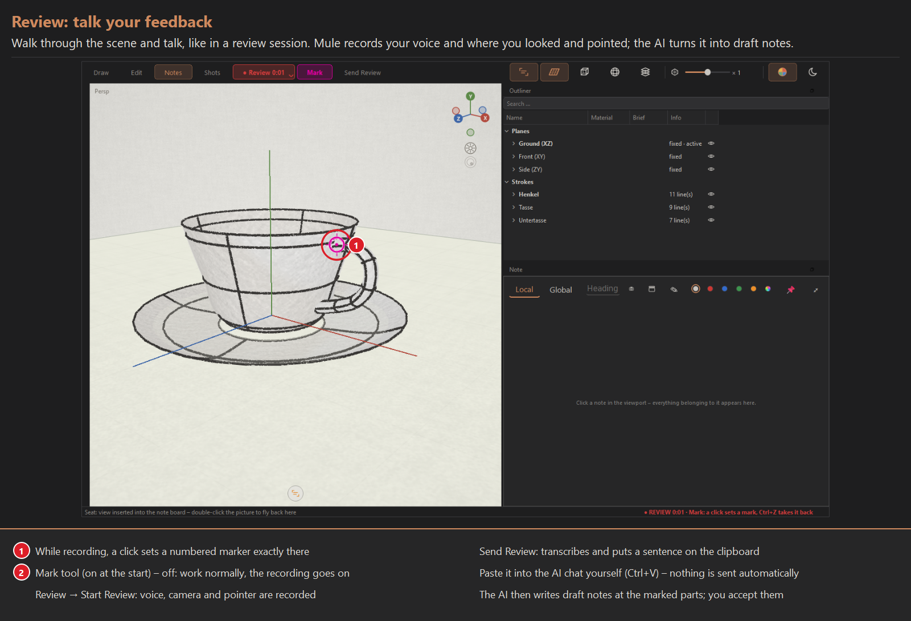

- **1** While recording, a click sets a numbered marker exactly there
- **2** Mark tool (on at the start) – off: work normally, the recording goes on
- Review → Start Review: voice, camera and pointer are recorded
- Send Review: transcribes and puts a sentence on the clipboard
- Paste it into the AI chat yourself (Ctrl+V) – nothing is sent automatically
- The AI then writes draft notes at the marked parts; you accept them

[← Export Sketch Brief (Ctrl+E)](#16-export-sketch-brief-ctrle) · [Contents](#contents) · [Shots: what happens when →](#18-shots-what-happens-when)

## 18. Shots: what happens when

Shots shows timing without animating: drawings per frame on flipbook layers, camera positions and notes about what happens between them.

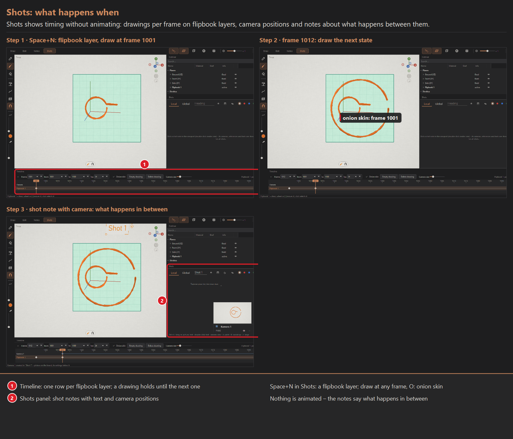

- **1** Timeline: one row per flipbook layer; a drawing holds until the next one
- **2** Shots panel: shot notes with text and camera positions
- Space+N in Shots: a flipbook layer; draw at any frame, O: onion skin
- Nothing is animated – the notes say what happens in between

[← Review: talk your feedback](#17-review-talk-your-feedback) · [Contents](#contents)
